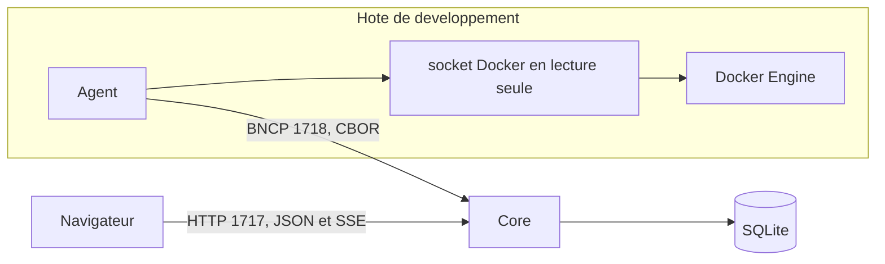

# Architecture

## Modules

```text
apps/core     serveur HTTP, authentification, réconciliation, projection
apps/agent    BrightNet Node : collecteurs hôte et Docker, envoi BNCP vers le Core
apps/web      interface Vue 3 et Cytoscape, servie par le Core sur le port 1717 quand elle est construite
internal      contrat partagé entre Core et agent
api           description OpenAPI du contrat HTTP
deploy        Docker Compose de développement
```

Le module Go unique se nomme `brightnet`. L'interface web est un projet npm séparé.



BNCP version 1 : 4 octets `BNCP`, un octet de version, un octet de type, deux octets de drapeaux, quatre octets de longueur, puis le corps. Les drapeaux doivent être nuls. Le corps dépasse 2 Mio est refusé. Les types vont de l'appairage aux événements. Le jeton d'agent voyage dans le corps des messages après l'appairage, jamais dans une commande.

L'interface et l'API JSON sont aussi disponibles sur `1717`. Le port `8787` conserve l'API seule, le temps que les clients existants basculent.

## Core

Responsabilités de cette version :

- créer l'administrateur local et les sessions ;
- appairer les agents et vérifier leurs jetons ;
- appliquer un instantané dans une transaction ;
- refuser la fusion d'entités dont la clé technique diffère ;
- marquer absentes les entités disparues uniquement si le collecteur concerné a réussi ;
- projeter les vues `docker`, `physical` et `logical` ;
- diffuser un événement SSE `graph.changed` après chaque changement ;
- conserver les positions du graphe par utilisateur et par vue.

Le Core ne collecte rien lui-même sur Docker ou sur le réseau.

## Agent

Deux collecteurs indépendants. L'échec de Docker est rapporté dans `collector_runs` et n'empêche pas l'envoi de l'hôte. Le Core ne retire pas les entités Docker si ce collecteur est en erreur.

Boucle :

1. S'appairer si aucun état local n'existe.
2. Envoyer un instantané.
3. Suivre le flux d'événements Docker, le transmettre, puis renvoyer un instantané après un court délai.
4. En cas de coupure, conserver le dernier instantané en mémoire et réessayer. Le tampon ne grandit pas au-delà de ce dernier état et d'une file bornée d'événements.

L'état d'appairage est un fichier `0600`.

## Interface

Le navigateur affiche la projection reçue. Il filtre, recherche et mémorise les positions, mais ne crée pas de lien qu'il n'a pas reçu. Les vues `dns`, `communications` et `application` sont sélectionnables et explicitement vides : aucune source ne les alimente encore.

## Contrat d'ingestion `brightnet.ingest.v1`

- `POST /api/v1/agents/enroll`
- `POST /api/v1/agents/{id}/heartbeat`
- `POST /api/v1/agents/{id}/snapshot`
- `POST /api/v1/agents/{id}/events`

La réponse d'ingestion contient `snapshot_interval_seconds` et `collectors`. Elle ne contient pas d'ordre d'exécution.

## Projection

`GET /api/v1/graph?view=docker|physical|logical`

Vue Docker : hôte, moteur, conteneurs, réseaux, volumes, et un service par conteneur qui publie des ports. Les ports individuels restent des propriétés.

Vue physique : hôte et interfaces.

Vue logique : hôte, interfaces et adresses.

Les autres vues renvoient un graphe vide et `available: false`.

## Starlink

Le collecteur n'existe pas encore. Quand il sera activé, il ne parlera qu'aux deux adresses configurées, avec la liste blanche de `docs/INTEGRATIONS.md`. Une antenne absente n'efface pas le graphe Docker. Les courbes ne sont pas des nœuds. La vue `communications` ne se remplira pas avec le débit satellite.
